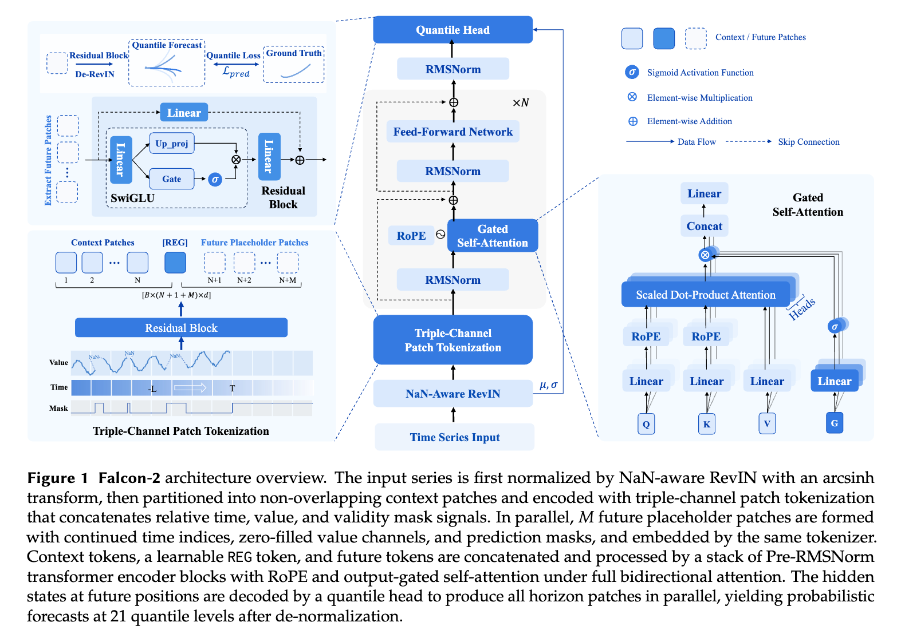

# Falcon-2: Into the ORBIT for Time Series: Training Regimes for Foundation Model

## Model Architecture

<div align="center">

</div>

## Installation

Install the package from [PyPI](https://pypi.org/project/falcon-tst/):

```bash
pip install falcon-tst
```

## Usage

### Notation

Throughout this document we follow the conventions below:

| Symbol | Meaning |
|--------|---------|
| `B` | Batch size (number of input series) |
| `L` | Lookback length — number of historical time steps in `context` |
| `H` | Horizon — number of future steps to forecast (`prediction_length`) |
| `Q` | Number of predicted quantiles (`Q = 21`) |

### Quick Start

```python
import numpy as np
from falcontst import FalconClient

# Prepare inputs
batch_size = 32
context_length = 512
prediction_length = 96

context = np.random.randn(batch_size, context_length)
input_mask = np.ones_like(context)

client = FalconClient()
result = client.quantile_predict(
    context=context,
    prediction_length=prediction_length,
    model_name="Falcon-2.0",
    input_mask=input_mask  # 1 = observed, 0 = missing
)

print(result)
```

### Output Format

The return value `result` is a dictionary containing the key `prob_prediction`:

```python
prob = np.array(result['prob_prediction'])  # shape: (B, Q, H)
```

Where:
- **B**: batch size (number of input series)
- **Q**: number of quantiles — 21 quantiles: `[0.01, 0.05, 0.10, ..., 0.90, 0.95, 0.99]`
- **H**: prediction horizon (`prediction_length`)

To obtain the point prediction (median), take the middle quantile (index 10):

```python
point_prediction = prob[:, 10, :]  # median (quantile = 0.5)
```

### Parameters

| Parameter | Type | Description |
|-----------|------|-------------|
| `context` | `np.ndarray` | Input time series of shape `(B, L)`. Supports `np.nan` for missing values. |
| `prediction_length` | `int` | Forecast horizon `H` (number of future steps to predict). |
| `model_name` | `str` | Model to use. `None` for the default model. |
| `input_mask` | `np.ndarray` | Binary mask of shape `(B, L)`. `1` = observed, `0` = missing. |

### GIFT-Eval Benchmark

Run all cells in [eval/falcon-2.ipynb](eval/falcon-2.ipynb) to reproduce the full GIFT-Eval evaluation. The GIFT-Eval dataset directory must be available — follow the [instructions](https://github.com/SalesforceAIResearch/gift-eval/tree/main#installation) to download it.

Upon completion, the following file is generated:

| File | Content |
|------|---------|
| `all_results.csv` | Per-dataset/term MASE and CRPS metrics |

## Citation

Coming soon.

## License

This project is licensed under the Apache License 2.0 - see the [LICENSE](LICENSE) file for details.